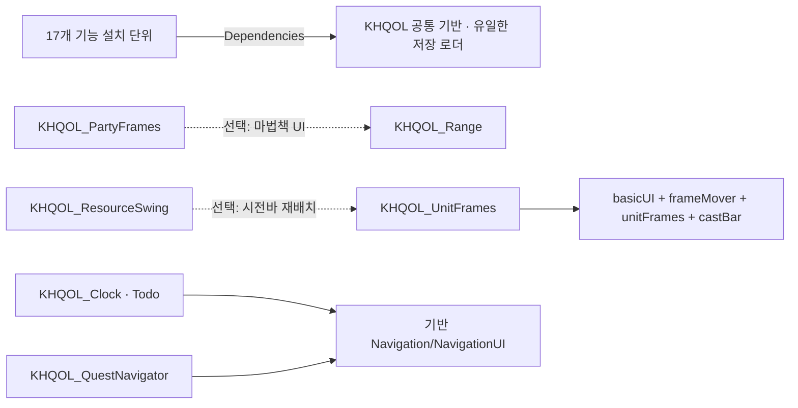

# KHQOL 1.11.2 인계

2026-10-17. KHQOL 1.11.1.2와 KH_map 1.0.0을 기준으로 미니맵 선택 모듈과 계정 공용 파티 프레임 프로필을 구현했습니다. 19개 폴더 / 281개 파일입니다. 현재 설치 절차는 [INSTALL-GUIDE.md](INSTALL-GUIDE.md), 검증 범위는 [CHANGE-VALIDATION-REPORT.md](CHANGE-VALIDATION-REPORT.md)를 따릅니다.

자동·모의 검사 312개 통과. 실제 게임 검증은 미실시입니다. 입력 ZIP과 실제 AddOns·WTF는 변경하지 않았습니다. 기존 KH_map 저장을 위해 폴더명을 유지했고, 기존 파티 프로필은 각 캐릭터 첫 접속 때 계정 목록에 합칩니다.

## 과거 인계 원문

아래는 이전 버전 기록입니다. 설치 폴더 수·버전·검사 수·저장 소유권에 대한 현재 변경은 위의 1.11.2 안내가 우선합니다.

# KHQOL 1.11.0.1 최종 인계

> 보존 자료: 이 문서 본문은 기준 1.11.0.1의 설치 분리/버전 변경 인계 기록입니다. 1.11.1.0은 같은 설치 구성과 공개 계약을 유지합니다. 이번 유지보수 변경·검증 및 인게임 체크리스트는 설치 ZIP 밖에 별도 제출한 1.11.1.0 자료를 따릅니다. 과거 검사 결과를 이번 실게임 확인 완료로 간주하지 않습니다.

2026-10-16 · 기준 1.10.10 TEST-FULL · 결과 1.11.0.1.

## 인계 상태

코드·18개 설치 폴더·문서·전체 ZIP은 구현 완료, 자동/모의 242개 통과입니다. 실제 게임은 미실시이며, 기준본 2단계의 핵심 보호/입력/저장 확인도 완료로 승격하지 않았습니다. 실제 게임 확인 전 최종 안정 배포 판정은 보류합니다.

## 의존성 그래프와 지원 설치 조합

모든 기능은 공통 기반만 필수입니다. `KHQOL_UnitFrames` 내부의 UnitFrames→BasicUI 코드 의존은 유지하지만 ON/OFF를 강제로 함께 바꾸지 않습니다. PartyFrames는 UnitFrames에 코드/활성 의존이 없습니다. Clock/Todo, Tooltip/WeaponGuide는 실제 공유 객체를 유지하는 묶음입니다. Labs는 기존 실험실 잠금/개발 도구 설치 단위입니다. 나머지는 독립 런타임·설정·이벤트를 가진 기능입니다.

TOC 선택 의존 방향은 PartyFrames→Range, ResourceSwing→UnitFrames입니다. 역방향 런타임 연결은 로그인 후 존재 확인을 거쳐 수행하므로 TOC 순환을 만들지 않습니다. 개인 프레임/파티의 Blizzard 기본 UI 선택 의존은 해당 기능 TOC에만 둡니다. 새로운 LoadOnDemand나 상시 polling은 없습니다.

구성상 기반만, 기반+단일 기능 단위, 모든 부분 집합, 전체 설치를 지원합니다. 실제 자동/모의 실행 범위는 검증 보고서와 원시 결과를 구분해서 읽어야 합니다. 모든 부분 집합을 게임에서 검사한 것은 아닙니다.

## 공통 코드와 인터페이스

| 파일/인터페이스 | 책임 |
|---|---|
| `KHQOL/Bootstrap.lua` | 공용 `_G.KHQOL`, VERSION, 안전 API 읽기, 기본값 merge, 공용 글꼴/직업색 |
| `ModuleRegistry.lua` | 등록·의존 검증·한 번 초기화·실패 재시도·실행·작업 소유·전투 최신 요청·프로필 연결 |
| `Installation.lua` | 설치 카탈로그/상태·데이터 스키마 소유·모든 등록 후 준비·프로필 마이그레이션/적용 연결 |
| `Profiles.lua`, `ProfileTransfer.lua` | 프로필·내용/개인 데이터 필터·휴면 스냅샷 보존·기존 전송 포맷 |
| `UI.lua`, `UI/Settings*.lua`, `SettingsUI.lua` | Design System v2.0·동적 행·컨트롤·탭·검색·창·설치 상태 |
| `UI/SettingsGroups.lua` | 설치된 빌더·등록 ID에 맞게 탭/페이지/명령/검색 연결 확정 |
| `PositionEditor.lua`, `PositionTargets.lua`, `UI/PositionStore.lua` | 일반 좌표·완료/취소·안전 편집/저장, 등록 제공자 수집·드래그 정리 |
| `Navigation.lua`, `NavigationUI.lua` | Clock/Todo와 Quest가 공유하는 내비게이션 엔진·HUD |
| `Modules/LabLock.lua` 등 | 종전 인증·실험실 잠금·전체 초기화 범위 |
| `Modules/GraphicsJournal.lua` | 기존 그래픽 변경의 상태/저널/안전 복원. Labs가 없을 때도 원본 기록 보존·복원. 기능 적용은 Labs 소유 |
| `AuraReader.lua`, `UI/AlertLayout.lua` | 공용 안전 판독·설치된 알림 프레임의 충돌 정리 |

기능별 `Bootstrap.lua`는 실제 애드온명만 첫 인자로 사용하고 공유 객체는 명시적으로 `_G.KHQOL`에서 가져옵니다. 기반 누락은 TOC와 부트스트랩에서 명확히 실패합니다. 미설치 모듈용 빈 실행 객체를 기반에 만들지 않습니다.

`ModuleRegistry:Register(id,spec)`의 기본 계약은 유지합니다. requires/optional은 초기화 순서이며 다른 기능의 사용자 토글을 바꾸지 않습니다. 같은 spec 재등록은 멱등이고 다른 spec의 ID 중복은 실패합니다. 설치 확정 이후 신규 등록은 UI 다시 로드를 요구합니다.

기존 `initialize`, `setEnabled`, `defaults`, `capture/restore`, `profileChanged/applyProfile`, `positions`, `settings`, `resetProfile/resetScope` 외에 연결용 `afterApplyProfile`, `migrateSettings`, `closeEditors`, `dragFrames/finishDrags`, `editorPositions`, `alertFrames`, `handleCommand`, `availability`를 사용합니다. 해당 콜백은 기능의 Adapters.lua가 등록합니다. Party의 기본 등록과 설정은 종전 `UI/PartyFrameSettings.lua`에 있습니다.

Core는 `VARIABLES_LOADED`(로그인 준비 fallback 포함)에서 전체 등록을 검증·설정 연결을 확정하고 프로필을 준비합니다. 기능 초기화와 로그인 후 단발 적용은 기존 이벤트를 유지합니다. ResourceSwing과 Campfire가 준비 전에 DB를 정규화하지 않게 했습니다. 프로필 적용은 설치된 콜백과 모듈만 호출하고 지연 작업 세대·최신 DB 재조회를 유지합니다.

## 데이터 소유권과 이관

| 범위 | 변수 | 유일한 TOC/파일 소유자 |
|---|---|---|
| 계정 | KHQOLDB, ForeverClockDB, ForeverBuffReminderDB, ForeverWeaponGuideDB, KHQOLResourceSwingDB, CampfireAlertDB, KHQOLLabDB | `KHQOL/KHQOL.toc` → 계정 SavedVariables/KHQOL.lua |
| 캐릭터 | FRangeDB, KHQOLCursorTrailCharDB, KHQOLPartyCharDB | `KHQOL/KHQOL.toc` → 해당 캐릭터 SavedVariables/KHQOL.lua |

저장 이름이 같다는 이유만으로 호환을 주장하지 않고, **폴더·TOC 로더 소유자까지 원래 KHQOL로 유지**했습니다. 새 애드온에는 SavedVariables 선언이 없습니다. 따라서 파일 이관 자체가 필요 없고 이관 성공 플래그도 새로 만들지 않았습니다. 기존 정상화/구형 프로필·파티 캐릭터 이관은 성공 후 마커 정책과 원본 보존을 유지합니다.

미설치 모듈의 현재 DB는 실행용 기본값으로 교체하지 않습니다. 저장된 선택 프로필의 휴면 스냅샷·enabled 선호를 캡처·복사 시 보존하고, 없는 스냅샷 때문에 기존 live 데이터를 지우지 않습니다. 재설치 시 현재 선택한 스냅샷을 사용합니다. 알 수 없는 모듈과 확장 키도 보존합니다. 내용 목록은 종전 공용/캐릭터 저장소에 남고 표시 프로필의 초기화로 지우지 않습니다.

실제 사용자 WTF는 읽거나 수정하지 않았습니다. 시험 데이터는 1.10.10 소스를 모형에서 실행해 생성한 사본입니다. 새 VM에 같은 TOC 소유 변수만 주입하여 업그레이드/제거/재설치/두 번째 캐릭터/구형 소스 복귀를 검사했습니다. 이는 게임 저장 파일 I/O 실측과 다릅니다.

프로필 전송은 기존 KHQOL1 형식·scope를 유지하고 설치된 스키마를 사용합니다. 미설치/알 수 없는 설정의 문자열 백업에는 범위 제한이 있으므로 전체 데이터 백업은 WTF 사본을 사용합니다. 복귀 절차와 한계는 `INSTALL-GUIDE.md`에 있습니다.

## 기능별 파일 위치

모든 경로는 AddOns 기준입니다. 각 기능의 공통 연결은 해당 폴더 `Adapters.lua`, 대부분의 위치 제공자는 `Positions.lua`, 정적 검색은 `UI/SearchIndex.lua`입니다. 전체 로드 파일 목록은 `docs/MODULE-FILES.csv`에 있습니다.

| 폴더 | 모듈 ID | 주 실행 파일 (폴더 안) | 주 설정 파일 (폴더 안) |
|---|---|---|---|
| `KHQOL_UnitFrames` | `basicUI`, `frameMover`, `unitFrames`, `castBar` | `Modules/BasicUI.lua`, `Modules/UnitFrames.lua`, `Modules/UnitFrameDecor.lua`, `Modules/UnitFrameStatus.lua`, `Modules/UnitFrameDisplay.lua`, `Modules/UnitFrameAuras.lua`, `Modules/UnitFramePositions.lua`, `CastBar/Core.lua` 외 | `CastBar/Settings.lua`, `UI/UnitFrameDetails.lua`, `UI/InterfaceTabs.lua`, `UI/castBarTab.lua`, `UI/SearchIndex.lua` |
| `KHQOL_PartyFrames` | `partyFrames` | `Modules/PartyFrames.lua`, `Modules/PartyFrameProfiles.lua`, `Modules/PartyFrameLayout.lua`, `Modules/PartyFrameDisplay.lua`, `Modules/PartyFrameAuras.lua`, `Modules/PartyFrameWheel.lua`, `WheelBook.lua` | `UI/PartyFramePreview.lua`, `UI/PartyFrameSpellBook.lua`, `UI/PartyFrameSettings.lua` |
| `KHQOL_Clock` | `clock`, `todo` | `Clock/Locale.lua`, `Clock/Core.lua`, `Clock/Clock.lua`, `Clock/ClockTools.lua`, `Clock/Modules.lua`, `Clock/Professions.lua`, `Clock/Calendar.lua`, `Clock/Minimap.lua` 외 | `Clock/Settings.lua`, `UI/InterfaceTabs.lua`, `UI/NoteSettings.lua`, `UI/SearchIndex.lua` |
| `KHQOL_Convenience` | `general`, `generalConvenience`, `chatEnhancement` | `Modules/ChatEnhancement.lua`, `GeneralOptions.lua`, `Modules/GeneralConvenience.lua`, `Modules/ConvenienceItems.lua`, `Modules/EquipmentLevels.lua` | `UI/ConvenienceDetails.lua`, `UI/ConvenienceTab.lua`, `UI/SearchIndex.lua` |
| `KHQOL_Tooltip` | `tooltip`, `weaponGuide` | `Tooltip/Core.lua`, `Tooltip/WeaponGuideData.lua`, `Tooltip/WeaponGuideProvider.lua`, `Tooltip/PlayerInfo.lua`, `Tooltip/Settings.lua` | `Tooltip/Settings.lua`, `UI/InterfaceTabs.lua`, `UI/SearchIndex.lua` |
| `KHQOL_Range` | `range` | `Range/Database.lua`, `Range/Range.lua`, `Range/Display.lua`, `Range/Mouseover.lua`, `Range/Settings.lua`, `Range/Core.lua` | `Range/Settings.lua`, `UI/InterfaceTabs.lua`, `UI/SearchIndex.lua` |
| `KHQOL_CursorTrail` | `cursorTrail` | `CursorTrail/Core.lua`, `CursorTrail/Settings.lua` | `CursorTrail/Settings.lua`, `UI/InterfaceTabs.lua`, `UI/SearchIndex.lua` |
| `KHQOL_ResourceSwing` | `resourceSwing` | `ResourceSwing/KHQOLResourceSwing.lua` | `UI/resourceSwingTab.lua`, `UI/SearchIndex.lua` |
| `KHQOL_ExperienceBar` | `experienceBar` | `Modules/ExperienceBar.lua` | `UI/ExperienceSettings.lua`, `UI/experienceBarTab.lua`, `UI/SearchIndex.lua` |
| `KHQOL_EnvironmentTimer` | `environmentTimer` | `Modules/EnvironmentTimer.lua` | `UI/Settings.lua` |
| `KHQOL_CombatStatus` | `combatStatus` | `Modules/CombatStatus.lua` | `UI/SettingsTab.lua`, `UI/SearchIndex.lua` |
| `KHQOL_Threat` | `threat` | `Modules/Threat.lua` | `UI/SettingsTab.lua`, `UI/SearchIndex.lua` |
| `KHQOL_NPCAlert` | `npcAlert` | `Modules/NPCAlert.lua` | `UI/NPCAlertSettings.lua`, `UI/SearchIndex.lua` |
| `KHQOL_PvPAlert` | `pvpAlert` | `Modules/PvPAlert/Core.lua`, `Modules/PvPAlert/Range.lua`, `Modules/PvPAlert/Scanner.lua`, `Modules/PvPAlert/ThreatEngine.lua`, `Modules/PvPAlert/Alerts.lua`, `Modules/PvPAlert/Settings.lua` | `Modules/PvPAlert/Settings.lua`, `UI/SettingsTab.lua`, `UI/SearchIndex.lua` |
| `KHQOL_Campfire` | `campfire` | `Campfire/Core.lua`, `Campfire/Aura.lua`, `Campfire/UI.lua`, `Campfire/Debug.lua` | `UI/Settings.lua` |
| `KHQOL_QuestNavigator` | `questNavigator` | `QuestNavigator/Core.lua`, `QuestNavigator/Tracker.lua`, `QuestNavigator/Selection.lua`, `QuestNavigator/UI.lua`, `QuestNavigator/Settings.lua` | `QuestNavigator/Settings.lua`, `UI/InterfaceTabs.lua`, `UI/SearchIndex.lua` |
| `KHQOL_Labs` | `buffReminder`, `procAlert`, `objectHighlight`, `frameInspector`, `performanceMonitor` | `Modules/ObjectHighlight.lua`, `BuffReminder/Core.lua`, `BuffReminder/UI.lua`, `BuffReminder/Settings.lua`, `Modules/ProcAlert.lua`, `Modules/FrameInspector.lua`, `Modules/PerformanceMonitor.lua` | `BuffReminder/Settings.lua`, `UI/LabSettings.lua`, `UI/SearchIndex.lua` |

일부 설정은 기능의 `Settings.lua` 또는 실행 파일 내 BuildSettings에 있습니다. 기본/개인 프레임의 보안 XML은 UnitFrames 폴더에, 파티 보안 XML은 PartyFrames 폴더에 있습니다. 노트 동작은 Clock 애드온 루트의 `Bindings.xml`에만 등록하며 기존 `KHQOL/Bindings.xml`은 빈 호환 파일로 유지합니다. 두 파일을 TOC에서 별도로 로드하지 않습니다. 18개 목록 아이콘은 KHQOL 공통 미니맵 이미지 1개를 참조합니다.

## 리소스·성능·복원

글꼴 1사본·공용 미니맵/설정 질감·공용 환경 HUD·경고음·내비게이션 아이콘·SoftGlow는 KHQOL에 남깁니다. Clock 전용 소리/버튼 질감/노트 아이콘과 CombatStatus의 검 이미지는 소유 폴더로 이동하고 경로를 맞춥니다. 다른 기능은 Clock.FONT_PATH 대신 공용 FONT_PATH를 사용합니다. 32자산은 원본과 같고 중복 해시는 없습니다.

성능 모니터는 분리 폴더 전체를 합산합니다. 모듈 최대 합은 상한 성격의 지표이며 실제 동시 전체 최대와 구분합니다. 그래픽 복원부는 기존 알고리즘을 공유하고 적용부는 Labs에 둡니다. 복원 보류 시 기록을 유지하며, 없는 Labs 때문에 전체 초기화가 복원 기록을 먼저 지우지 않습니다.

## 남은 확인과 배포 판단

자동/모의 실패 0. 실제 게임 검사 미실시. 파티 클릭·휠·외부 바인딩, 전투 중 값 갱신과 보호 복원, 실제 저장·재접속·다른 캐릭터, Design System v2.0 글자·입력·작은 창, 기본 게임 UI 회귀와 성능을 설치 안내의 표대로 확인해야 합니다. 과거 2단계 실게임 미확인도 별도로 남습니다.

사용 조건·원본 자산 출처의 확인 범위는 `ATTRIBUTION.md`를 따릅니다. 입력 ZIP에 없는 포괄적 배포 허가를 새로 주장하지 않습니다. 공개 배포/게임 설치/실제 저장 변경은 이번 작업에서 수행하지 않았습니다.
